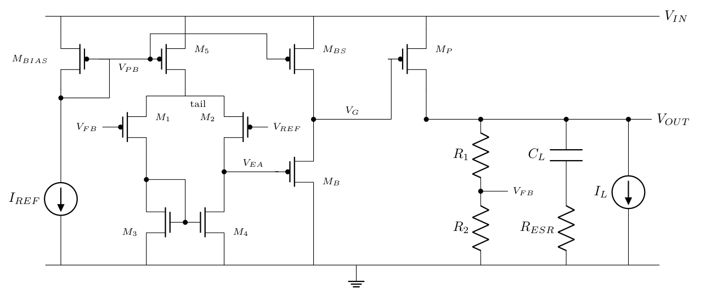

# CMOS Low-Dropout Regulator (0.18 µm): theory, hand design and ngspice verification

A 1.5 V, 50 mA PMOS low-dropout (LDO) regulator designed from a written specification. Every formula
used in the design is proved, every transistor is sized by hand, and the result is checked in ngspice.



## Documents

| File | Content |
|---|---|
| [`doc/ldo_theory_proofs.pdf`](doc/ldo_theory_proofs.pdf) | **Part 1, theory (6 pages).** Proofs of the formulas: square law, triode and weak-inversion small-signal parameters; loop polarity; the static output equation (accuracy, load and line regulation from one equation); pass-device and headroom conditions; loop gain, poles and ESR zero; unity-gain frequency and phase margin; why the error-amplifier pole does not depend on its current; ESR window; PSRR (including its collapse near dropout); load-step response. |
| [`doc/ldo_hand_design.pdf`](doc/ldo_hand_design.pdf) | **Part 2, hand design (7 pages).** Parameter extraction from the BSIM3 model; step-by-step calculation of every W/L, bias current and resistor from the specification; simulation results; three design iterations; a hand-versus-simulation table with the reasons for each gap; VIN and temperature corners. |

## Specification and simulated results (final design, typical model, 27 °C)

| Quantity | Condition | Spec | Simulated |
|---|---|---|---|
| Output voltage | VIN 1.7–1.9 V, IL 0.1–50 mA | 1.5 V | 1.4954–1.5053 V |
| Dropout | IL = 50 mA, VOUT within 1 % | ≤ 200 mV | 141 mV |
| Phase margin | all loads, ESR 0–50 mΩ, VIN/T corners | ≥ 45° | 71.1° nominal, 60.0° worst |
| PSRR | 1 kHz, 50 mA, VIN = 1.8 V | ≥ 30 dB | 31.0 dB |
| Load regulation | 0.1 → 50 mA | ≤ 15 mV | 9.9 mV |
| Line regulation | 1.7 → 1.9 V | ≤ 35 mV/V | 29.9 mV/V (worst load) |
| Quiescent current | incl. divider | ≤ 100 µA | 84.7 µA |
| Load transient | 0.1 ↔ 50 mA, 1 µs edges | ≤ 50 mV | 9.9 mV |

Output capacitor: 2.2 µF ceramic. Margins that are thin are listed openly in Part 2, Section 4.4. PSRR is
29.8 dB at VIN = 1.9 V, 0 °C, light load (headroom limit of the error amplifier). Near dropout (VIN = 1.7 V,
85 °C) the PSRR falls to 15.6 dB because the pass device enters triode.

## Architecture

- **Pass device:** PMOS, 300 × 10 µm / 0.18 µm.
- **Error amplifier:** five-transistor OTA with a PMOS input pair (VREF = 0.6 V). The input pair uses
  L = 1 µm and the NMOS mirror uses L = 3 µm.
- **Buffer:** PMOS source follower (bulk tied to source) that drives the 7 pF pass-device gate.
- **Feedback:** resistive divider, 90 kΩ / 60 kΩ.
- **Bias and reference:** ideal 5 µA bias current; ideal VREF (no bandgap in this project).

## How the design evolved

| Version | Change | Result |
|---|---|---|
| v1 | L = 1 µm in the error amplifier | stable (PM 81°), but PSRR 28.8 dB and line regulation 39 mV/V miss the spec |
| v2 | L = 2 µm for all four EA devices | meets the spec at nominal, but PM drops to 44° at a corner with ESR = 0, and PSRR to 22 dB at VIN = 1.9 V |
| v3 | only the mirror lengthened (3 µm); buffer V_SG set from a headroom window | meets all specs at nominal, PM about 60° or more at all corners |

The hand calculation overestimated the error-amplifier gain (164 against 99 simulated). The square-law
g_m/I_D is 20 V⁻¹, but the simulated value is 16.6 V⁻¹, and the effective λ is higher at the real
operating points. With the simulated g_m and g_ds put back into the same formulas, the loop gain, the
unity-gain frequency and the load regulation agree with simulation to within about 1 dB, 7 % and 0.5 mV.

## Repository layout

```
doc/        ldo_theory_proofs.pdf, ldo_hand_design.pdf and their sources (*.tex.in, schematic.tex)
scripts/    Python flow: device characterisation, hand design, simulations, document rendering
            + all results as JSON (params, hand, sizes_v1..v3, sim_*_v1..v3)
figures/    plots used in the documents
netlists/   final circuit (v3) with operating-point, loop-gain, PSRR, line, load and load-step test benches
sim/        working folder for ngspice runs (place the model file here)
```

## Reproducing

Tools: ngspice-46 (batch mode), Python 3 with numpy, scipy and matplotlib, and
[Tectonic](https://tectonic-typesetting.github.io/) for the PDFs.

The 0.18 µm BSIM3v3.1 model file used (`cmos180.lib`, 1.8 V devices, t_ox = 4.1 nm, from university
coursework) is **not redistributed**. Put a BSIM3 model file defining `.model NMOS` and `.model PMOS` at
`sim/cmos180.lib` (and next to the netlists if you run those directly). Set the environment variable
`NGSPICE` to `ngspice_con` if it is not at the default Windows path.

```
cd scripts
python char_devices.py                      # square-law parameters, gm/ID plot
python design.py                            # hand design -> sizes_v1/v2/v3.json, hand.json
# for N in 1 2 3:  LDO_SIZES=sizes_vN.json  LDO_VER=vN
python sim_op.py && python sim_all.py && python sim_extra.py
python render.py path/to/tectonic           # fill numbers into both documents and build the PDFs
```

Every number in the two PDFs is filled in by `render.py` from the JSON results; none is typed by hand.

## Limitations

The model is typical only: no process corners and no Monte Carlo mismatch analysis. VREF and the bias
current are ideal. The work is at schematic level, with no layout parasitics or bond-wire inductance.
Start-up, current limit, noise and soft-start are not covered.
