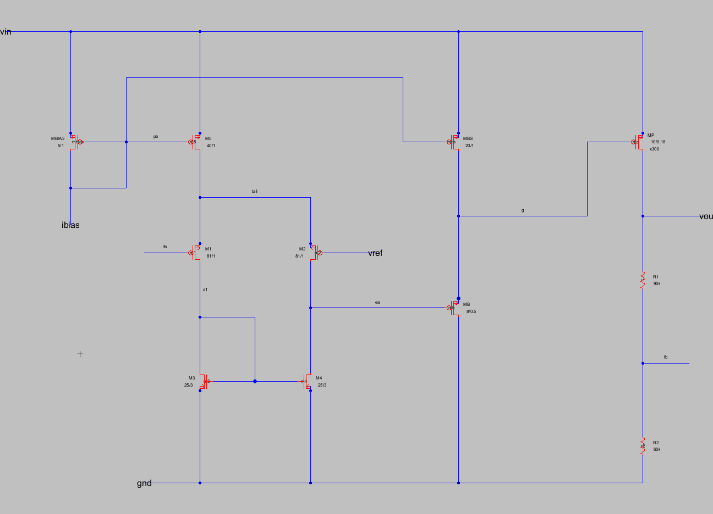

# CMOS Low-Dropout Regulator (0.18 µm): theory, hand design and ngspice verification

A 1.5 V, 50 mA PMOS low-dropout (LDO) regulator designed from a written specification. Every formula
used in the design is proved, every transistor is sized by hand following the system-level LDO design
procedure of G. A. Rincón-Mora [1, 2], and the result is checked in ngspice.



Schematic of the final design (v4) in the Electric VLSI editor, cell `ldo180{sch}` of
[`schematic/ldo180.jelib`](schematic/ldo180.jelib). Labels give W/L in µm (×300 = number of parallel
pass-device fingers, M = 300). Its netlist matches the simulated circuit device by device (see
[Schematic in Electric](#schematic-in-electric)). The PDFs use a redrawn version of the same circuit
([`figures/schematic.png`](figures/schematic.png)). *Note: this screenshot was taken before the v4 buffer
change and still shows MB = 12/0.5 and MBS = 30/1; v4 uses MB = 8/0.5 and MBS = 20/1 (the `.jelib` file
is already v4).*

## Documents

| File | Content |
|---|---|
| [`doc/ldo_theory_proofs.pdf`](doc/ldo_theory_proofs.pdf) | **Part 1, theory (7 pages).** Proofs of the formulas: square law, triode and weak-inversion small-signal parameters; loop polarity; the static output equation (accuracy, load and line regulation from one equation); pass-device and headroom conditions; loop gain, poles and ESR zero; unity-gain frequency and phase margin; why the error-amplifier pole does not depend on its current; ESR window; PSRR (including its collapse near dropout); load-step response; the worst-case load-step budget of [1]. |
| [`doc/ldo_hand_design.pdf`](doc/ldo_hand_design.pdf) | **Part 2, hand design (9 pages).** Parameter extraction from the BSIM3 model; the eight-step design procedure of [1, 2] applied to the specification, with every W/L, bias current and resistor; simulation results; four design iterations; a hand-versus-simulation table with the reasons for each gap; VIN and temperature corners. |

## Specification and simulated results (final design v4, typical model, 27 °C)

| Quantity | Condition | Spec | Simulated |
|---|---|---|---|
| Output voltage | VIN 1.7–1.9 V, IL 0.1–50 mA | 1.5 V | 1.4954–1.5053 V |
| Dropout | IL = 50 mA, VOUT within 1 % | ≤ 200 mV | 141 mV |
| Phase margin | all loads, ESR 0–50 mΩ, VIN/T corners | ≥ 45° | 68.3° nominal, 57.0° worst |
| PSRR | 1 kHz, 50 mA, VIN = 1.8 V | ≥ 30 dB | 31.0 dB |
| Load regulation | 0.1 → 50 mA | ≤ 15 mV | 9.9 mV |
| Line regulation | 1.7 → 1.9 V | ≤ 35 mV/V | 29.9 mV/V (worst load) |
| Quiescent current | incl. divider | ≤ 100 µA | 74.9 µA |
| Load transient | 0.1 ↔ 50 mA, 1 µs edges | ≤ 50 mV | 9.9 mV |

Output capacitor: 2.2 µF ceramic. Margins that are thin are listed openly in Part 2, Section 4.4. PSRR is
29.8 dB at VIN = 1.9 V, 0 °C, light load (headroom limit of the error amplifier). Near dropout (VIN = 1.7 V,
85 °C) the PSRR falls to 15.6 dB because the pass device enters triode.

## Design procedure

Part 2 follows the order of Rincón-Mora's dissertation [1, Chapter II and Section 6.1] and the JSSC paper
by Rincón-Mora and Allen [2]. Each formula is used in the form proved in Part 1.

| Step | What it fixes | Source | Result |
|---|---|---|---|
| 1 Topology | PMOS common-source pass device, buffered architecture, 5-T OTA | [1, Table 6.1, Fig. 2.7], [2, Fig. 8(a)] | PMOS input pair (VREF = 0.6 V) |
| 2 Feedback network | divider current as a quiescent-current overhead | [1, Sec. 2.1] | I_R = 10 µA, 90 kΩ / 60 kΩ |
| 3 Pass device | dropout W/L ≥ 10 465 and saturation at VIN,nom W/L ≥ 16 644 | [2, Eqs. (12)–(14)] | saturation binds: 300 × 10 µm / 0.18 µm |
| 4 Open-loop gain | load/line regulation and PSRR | [1, Eq. (2.9)] | G ≥ 31.6 (PSRR binds) |
| 5 Transient budget | response time allowed by the 50 mV limit | [1, Eqs. (2.10)–(2.12)] | Δt1 ≤ 2.18 µs |
| 6 Gain stage | common-mode range around VREF, output swing, gain, channel lengths | [1, Sec. 2.4], [2, Sec. IV] | L12 = 1 µm, L34 = 3 µm, 20 µA per side |
| 7 Buffer | pole at the pass-device gate above the UGF (PM ≥ 60° target), slew current | [2, Eq. (3)], [1, Eq. (2.12)] | I_B = 20 µA |
| 8 Quiescent current | current efficiency | [2, Eq. (1)] | 75 µA (57 % efficiency at 0.1 mA) |

Steps 6 and 7 run twice. Pass A uses square-law parameters only; it overestimates the error-amplifier gain
(164 against 99 simulated), so the unity-gain frequency comes out at 1.6 MHz and no buffer current can
reach the 60° target. Pass B uses g_m/I_D and λ read at the simulated operating point of the previous
design and predicts the final phase margin to within 1° (68.1° against 68.3° simulated; 61.1° against 61.9°
with ESR = 0) and the quiescent current to within 1 µA.

## Architecture

- **Pass device:** PMOS, 300 × 10 µm / 0.18 µm.
- **Error amplifier:** five-transistor OTA with a PMOS input pair (VREF = 0.6 V). The input pair uses
  L = 1 µm and the NMOS mirror uses L = 3 µm.
- **Buffer:** PMOS source follower (bulk tied to source), biased at 20 µA, that drives the 7 pF
  pass-device gate.
- **Feedback:** resistive divider, 90 kΩ / 60 kΩ.
- **Bias and reference:** ideal 5 µA bias current; ideal VREF (no bandgap in this project).

## Schematic in Electric

The final circuit (v4) is drawn in the [Electric VLSI](https://www.staticfreesoft.com/) 9.08 schematic
editor as cell `ldo180{sch}`: nine 4-terminal MOSFETs with their W/L (and M = 300 for the pass device) as
attributes, the two divider resistors, and five pins (`vin`, `gnd`, `vout`, `vref`, `ibias`). The ideal
bias current, VREF, the output capacitor with its ESR and the load are test-bench parts, not part of the
chip. The cell is built with Electric's database API from `schematic/gen_schematic.py` (wire by wire, so it
can be regenerated), and can be opened and edited in Electric as usual.

Electric's own SPICE writer turns the drawing into [`schematic/ldo180_electric.spi`](schematic/ldo180_electric.spi).
`schematic/check_netlist.py` then checks that this is the circuit behind every result:

1. **Netlist comparison.** All 11 devices of Electric's netlist match the Python netlist used for the
   simulations (`scripts/ldo_netlist.py`, `sizes_v4.json`): terminals (including the bulk of the input pair
   tied to the tail and the bulk of the follower tied to its source), model, W, L, M and R.
2. **Re-simulation.** The same test benches run on Electric's netlist give the published v4 numbers:

| Quantity | Published (v4) | Electric netlist |
|---|---|---|
| Load regulation, 0.1 → 50 mA | 9.88 mV | 9.89 mV |
| Line regulation, 50 mA | 29.94 mV/V | 29.94 mV/V |
| PSRR at 1 kHz, 0.1 / 50 mA | 31.44 / 31.02 dB | 31.44 / 31.02 dB |
| Load-step dip | 9.94 mV | 9.95 mV |
| Phase margin, 0.1 / 1 / 10 / 50 mA | 89.9 / 88.5 / 79.0 / 68.3° | 89.9 / 88.5 / 79.0 / 68.3° |
| DC loop gain, 0.1 / 1 / 10 / 50 mA | 58.6 / 59.5 / 58.9 / 52.3 dB | 58.6 / 59.5 / 58.9 / 52.3 dB |

The largest differences are 8.6 µV in the light-load output voltage and 0.0002 dB in PSRR, within the
tolerance of the ngspice solver. Two test-bench conventions apply to both flows: Electric writes sizes in
schematic units (µm) with `.opt scale=0.2U`, which the test bench replaces by `.option scale=1e-6`; and the
drain/source areas and perimeters (AD, AS, PD, PS), which are layout data and not part of a schematic, are
added with the same rule as in `ldo_netlist.py` (0.5 µm of diffusion on each side).

## How the design evolved

| Version | Change | Result |
|---|---|---|
| v1 | L = 1 µm in the error amplifier | stable (PM 81°), but PSRR 28.8 dB and line regulation 39 mV/V miss the spec |
| v2 | L = 2 µm for all four EA devices | meets the spec at nominal, but PM drops to 44° at a corner with ESR = 0, and PSRR to 22 dB at VIN = 1.9 V |
| v3 | only the mirror lengthened (3 µm); buffer V_SG set from a headroom window; buffer bias 30 µA by budget | meets all specs; Iq 84.7 µA, PM 71.1° (60.0° worst corner) |
| v4 | the procedure above: Step 6 reproduces the v3 lengths, Pass B of Step 7 sets the buffer bias to 20 µA | meets all specs; Iq 74.9 µA (−10 µA), PM 68.3° (57.0° worst corner) |

v1 and v2 measured the optimism of the square law that the 6 dB gain margin of Step 6 now covers, and
the shortest-L rule of Step 6 comes from v2 (longer input devices lower the error-amplifier pole).

## Repository layout

```
doc/        ldo_theory_proofs.pdf, ldo_hand_design.pdf and their sources (*.tex.in, schematic.tex)
scripts/    Python flow: device characterisation, hand design (design.py for v1-v3, design_flow.py for
            the procedure and v4), simulations, document rendering
            + all results as JSON (params, hand, hand_flow, sizes_v1..v4, sim_*_v1..v4)
figures/    plots used in the documents
netlists/   final circuit (v4) with operating-point, loop-gain, PSRR, line, load and load-step test benches
schematic/  Electric schematic (ldo180.jelib), its generator, Electric's SPICE netlist and the
            netlist / re-simulation check (check_netlist.py, check_netlist.json)
sim/        working folder for ngspice runs (place the model file here)
```

## Reproducing

Tools: ngspice-46 (batch mode), Python 3 with numpy, scipy and matplotlib, and
[Tectonic](https://tectonic-typesetting.github.io/) for the PDFs.

The 0.18 µm BSIM3v3.1 model file used (`cmos180.lib`, 1.8 V devices, t_ox = 4.1 nm, from university
coursework) is **not redistributed**. Put a BSIM3 model file defining `.model NMOS` and `.model PMOS` at
`sim/cmos180.lib` (and next to the netlists if you run those directly). Set the environment variable
`NGSPICE` to `ngspice_con` if it is not at the default Windows path.

```
cd scripts
python char_devices.py                      # square-law parameters, gm/ID plot
python design.py                            # earlier iterations -> sizes_v1/v2/v3.json, hand.json
# for N in 1 2 3:  LDO_SIZES=sizes_vN.json  LDO_VER=vN
python sim_op.py && python sim_all.py && python sim_extra.py
python design_flow.py                       # the procedure (Pass B reads the v3 operating point)
                                            # -> sizes_v4.json, hand_flow.json
# LDO_SIZES=sizes_v4.json  LDO_VER=v4, then the three simulation scripts again
python render.py path/to/tectonic           # fill numbers into both documents and build the PDFs
```

Every number in the two PDFs is filled in by `render.py` from the JSON results; none is typed by hand.

Schematic (needs Java and the Electric 9.08 jar; set `ELECTRIC_JAR` if it is not at
`C:\Electric\electricBinaryFull-9.08.jar`):

```
cd schematic
python gen_schematic.py                     # builds ldo180.jelib and writes ldo180_electric.spi
python check_netlist.py                     # device-by-device comparison + re-simulation
```

## Limitations

The model is typical only: no process corners and no Monte Carlo mismatch analysis. VREF and the bias
current are ideal. The work is at schematic level, with no layout parasitics or bond-wire inductance.
Start-up, current limit, noise and soft-start are not covered. As in v3, the phase margin at full load
falls below 45° somewhere between ESR = 0.2 Ω (70°) and 0.5 Ω (41°); the specified range is 0–50 mΩ.

## References

1. G. A. Rincón-Mora, *Current Efficient, Low Voltage, Low Drop-Out Regulators*, Ph.D. dissertation,
   Georgia Institute of Technology, 1996. Author's copy:
   <https://rincon-mora.gatech.edu/publicat/books/thesis/ldo_book.pdf>
2. G. A. Rincón-Mora and P. E. Allen, "A low-voltage, low quiescent current, low drop-out regulator,"
   *IEEE Journal of Solid-State Circuits*, vol. 33, no. 1, pp. 36–44, Jan. 1998. Author's copy:
   <https://rincon-mora.gatech.edu/publicat/jrnls/jssc98_lv_ldo.pdf>
